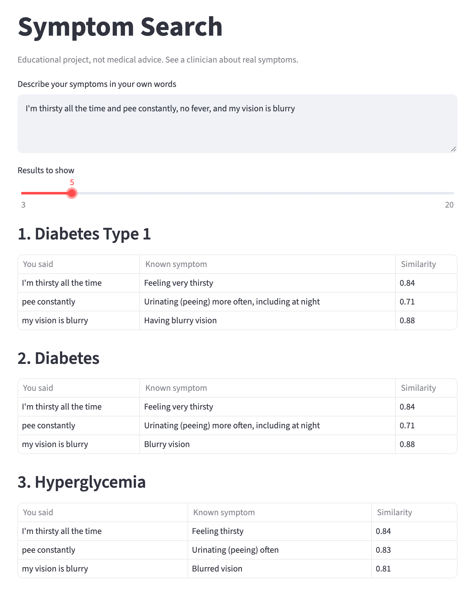

# Symptom Search

[](https://github.com/william5711/symptom-search/actions/workflows/tests.yml)

A semantic search engine that ranks 975 documents against a free-text query. Each document is a medical condition with its listed symptoms, and each query is a plain-English description of how someone feels. Results show which phrase in the query matched which symptom.

On two held-out test sets totaling 286 queries, it beats a TF-IDF keyword baseline on mean reciprocal rank (MRR): 0.40 vs 0.31 on written queries and 0.21 vs 0.13 on synthetic patients from an outside dataset. Nine embedding models were compared, with a correction for testing many at once, and a fine-tuning experiment was tried and dropped because it made results worse. The search corpus is built from three open sources by a pipeline that checks its own output.

<p align="center">
  
  <br><em>The Streamlit demo (<code>streamlit run app.py</code>) with the example query below.</em>
</p>

This is a learning project. It compares text and can't diagnose anything, so please don't use it for medical decisions.

Rewritten in 2026 with help from Claude. The original 2023 scripts are in `legacy/`.

```text
$ python -m symptom_search -k 3 "I'm thirsty all the time and pee constantly, no fever, and my vision is blurry"

1. Diabetes Type 1
     "I'm thirsty all the time" -> Feeling very thirsty (0.84)
     "pee constantly" -> Urinating (peeing) more often, including at night (0.71)
     "my vision is blurry" -> Having blurry vision (0.88)
2. Diabetes
     "I'm thirsty all the time" -> Feeling very thirsty (0.84)
     "pee constantly" -> Urinating (peeing) more often, including at night (0.71)
     "my vision is blurry" -> Blurry vision (0.88)
3. Hyperglycemia
     "I'm thirsty all the time" -> Feeling thirsty (0.84)
     "pee constantly" -> Urinating (peeing) often (0.83)
     "my vision is blurry" -> Blurred vision (0.81)
```

## How it works

The query is split into clauses, and clauses that deny a symptom ("no fever") are dropped. The rest are embedded with `all-MiniLM-L6-v2`. If no clause comes close to any listed symptom (cosine similarity below 0.55), the search returns nothing.

Documents are then ranked two ways:

- Clause matching finds the closest listed symptom for each clause, then scores it by similarity and by how rare the symptom is across the corpus.
- Whole-text matching compares the full query with the average vector of each document's symptoms.

Reciprocal rank fusion merges the two rankings. The scores only order results within a single query, and they aren't probabilities.

## Results

There are two held-out test sets. Brackets show 95% intervals (Wilson for Hit@3, bootstrap for MRR). Neither set comes from real patients.

**Written queries (100).** Descriptions in everyday language that avoid naming the condition, one per condition, written with Claude's help for this project. No condition appears in both these and the tuning queries. The conditions were chosen before checking whether the corpus had them, and 6 of the 100 have no entry.

| Method | Hit@1 | Hit@3 | Hit@10 | MRR |
|---|---:|---:|---:|---:|
| TF-IDF keywords | 0.200 | 0.390 [0.30, 0.49] | 0.500 | 0.306 [0.24, 0.38] |
| Original 2023 method (`pooler_output`) | 0.230 | 0.430 [0.34, 0.53] | 0.580 | 0.357 [0.28, 0.43] |
| Whole text, mean pooling | 0.330 | 0.450 [0.36, 0.55] | 0.600 | 0.420 [0.34, 0.50] |
| Clauses only | 0.250 | 0.360 [0.27, 0.46] | 0.430 | 0.319 [0.24, 0.40] |
| Hybrid (default) | 0.320 | 0.420 [0.33, 0.52] | 0.560 | 0.398 [0.32, 0.48] |

**DDXPlus patients (186).** Synthetic patients from [DDXPlus](https://doi.org/10.6084/m9.figshare.20043374), so nobody on this project wrote the cases or their diagnoses. `scripts/build_ddxplus_queries.py` turns their questionnaire answers into sentences. These read like a form, and the conditions lean toward acute care. 32 of the 186 have no entry.

| Method | Hit@1 | Hit@3 | Hit@10 | MRR |
|---|---:|---:|---:|---:|
| TF-IDF keywords | 0.032 | 0.140 [0.10, 0.20] | 0.349 | 0.129 [0.10, 0.16] |
| Original 2023 method (`pooler_output`) | 0.043 | 0.124 [0.08, 0.18] | 0.360 | 0.133 [0.10, 0.17] |
| Whole text, mean pooling | 0.059 | 0.188 [0.14, 0.25] | 0.473 | 0.175 [0.14, 0.21] |
| Clauses only | 0.086 | 0.161 [0.12, 0.22] | 0.306 | 0.159 [0.12, 0.20] |
| Hybrid (default) | 0.124 | 0.226 [0.17, 0.29] | 0.441 | 0.213 [0.17, 0.26] |

The hybrid gets the right condition into the top 3 for about 4 of 10 written queries and fewer than 1 of 4 DDXPlus patients, so treat the output as a rough shortlist. The gap between those two numbers suggests the written queries are easier than an outside test.

The hybrid's MRR beats TF-IDF on both sets: by 0.091 [0.007, 0.175] on the written queries and by 0.084 [0.037, 0.129] on DDXPlus. Whole-text matching scored higher on the written queries (MRR 0.420 vs 0.398) and at Hit@10 on both sets, while the hybrid was ahead on DDXPlus MRR.

Of 30 unrelated sentences held out for testing, such as "The train to Boston leaves from platform nine", the search answered 1 and returned nothing for the other 29. All 30 used for tuning returned nothing. The cutoff has a cost: it refused 3 of the 100 written test queries, and without it the hybrid's written MRR would be 0.418.

All settings were picked on tuning queries. The test sets have been run three times as the project changed, and only combined scores were looked at.

[docs/evaluation.md](docs/evaluation.md) has the rest: how the queries were labeled, what the data cleanup changed, the comparison of nine embedding models, the fine-tuning experiment, and the most common misses.

## Data

`data/diseases.csv` has 6,986 condition-symptom links from MedlinePlus, Wikidata, and the Human Disease Ontology. See [data/SOURCES.md](data/SOURCES.md) for terms and attribution.

The sources change over time, so the build has two steps:

- `scripts/fetch_sources.py` downloads the sources, saves what's needed in `data/sources/`, and records each one's URL, date, and checksum in `manifest.json`.
- `scripts/build_dataset.py` builds the dataset from those saved copies with no network access, so the same inputs always give the same file. It refuses to write the result if a row is empty or duplicated, a source is unknown, a non-condition slips in, or the entry count falls by more than 10%.

GitHub Actions runs the tests on every push, including a check that the dataset matches its saved sources. A monthly job reports how far the live sources have drifted. It doesn't commit anything, because a data change also means rerunning the benchmark.

The data is uneven. Conditions covered by MedlinePlus have plain-language symptoms, but the median entry lists only 5 symptoms and the longest lists 73.

Other limits:

- Common conditions are still missing, including anaphylaxis, obesity, and warts.
- Some entries are symptoms or broad categories, such as "Cough" and "Pain", and they can rank above a specific condition.
- Symptoms were pulled from text with rules, so some lines aren't really symptoms. When a MedlinePlus summary has no symptom wording, any sentence with a symptom word is used, which lets in more of these.
- Nothing accounts for age, sex, duration, or how common a condition is.

## Known problems

- The 0.55 cutoff only catches text with no close symptom at all. A real description that matches poorly can return nothing, and unrelated text that uses a body or health word can still get results.
- Negation is rule-based, so "I don't have any energy" gets read as a denial and dropped.

## Running it

Tested on Python 3.12, with exact versions pinned in `requirements.txt`. The model downloads on first run.

```bash
python3.12 -m venv .venv
source .venv/bin/activate
pip install -r requirements.txt

python -m symptom_search "I have a sore throat and a fever"
streamlit run app.py
python evaluate.py --split test
python evaluate.py --split test --queries ddxplus
python scripts/compare_models.py --split test
pytest
```

## Files

| Path | What it does |
|---|---|
| `symptom_search/data.py` | Loads the dataset |
| `symptom_search/text.py` | Splits clauses and detects negation |
| `symptom_search/embeddings.py` | Encodes text and caches vectors |
| `symptom_search/matcher.py` | Scores and ranks conditions |
| `scripts/fetch_sources.py` | Downloads the sources into `data/sources/` |
| `scripts/build_dataset.py` | Builds and validates the dataset from the saved sources |
| `scripts/compare_models.py`, `eval/model_settings.json` | Compares embedding models and stores their tuned thresholds |
| `scripts/finetune.py` | The fine-tuning experiment |
| `.github/workflows/` | Tests on every push, the monthly source check, and the demo deployment |
| `gradio_app.py`, `space/` | The online demo on Hugging Face Spaces and its settings |
| `evaluate.py`, `eval/` | Benchmark and labeled queries |
| `docs/evaluation.md` | Labeling, model comparison, fine-tuning, and error analysis |
| `scripts/build_ddxplus_queries.py` | Samples DDXPlus patients into benchmark queries |
| `app.py` | Streamlit demo for running locally |
| `tests/` | Unit tests, which run without the model |
| `legacy/` | The original 2023 scripts, which need a dataset that is no longer in this repo |

## License

The code is under the [MIT License](LICENSE). The data has its own terms, listed in [data/SOURCES.md](data/SOURCES.md).
